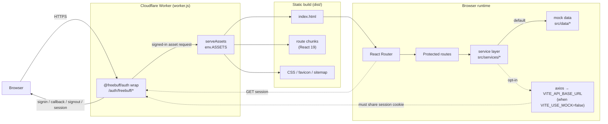

# CloudOps Command Center — Architecture

_Last reviewed 2026-10-20._

## 1. Summary

CloudOps is a **static React SPA** served by a **single Cloudflare Worker**.
The Worker does two jobs:

1. Serve the built assets and fall back to `index.html` for client-side
   routes.
2. Own authentication (`@freebuff/auth`) so the browser only ever holds an
   httpOnly session cookie.

There is no application database and no real infrastructure API yet: data
comes from bundled mock modules behind a service layer that already speaks
HTTP, so a real backend can be dropped in without touching the UI.



## 2. Runtime components

### 2.1 Worker (`worker.js`)

- Caches one auth instance per isolate (`auth`) and one wrapped handler
  (`wrappedApp`); `createFreebuffAuth` caches OIDC discovery and signing
  keys behind that instance.
- If `env.ASSETS` is missing → `500 Assets not bound` (fail loudly rather
  than serving nothing).
- If `env.FREEBUFF_CLIENT_ID` is set → builds
  `createFreebuffAuth({ clientId, issuer: env.FREEBUFF_ISSUER, baseUrl: env.APP_ORIGIN })`
  and routes every request through `wrap(serveAssets)`.
- Otherwise (local dev without vars) → `serveAssets` directly, so the demo
  runs without auth.
- `serveAssets` returns `env.ASSETS.fetch(request)`; on **404 with an
  `Accept: text/html`** request it re-fetches `/index.html`. Asset requests
  (Accept `*/*`) keep their 404, so a missing `.js` file is not masked by
  HTML.
- Auth endpoints intercepted by `wrap`: `/auth/freebuff/signin`,
  `/auth/freebuff/callback`, `/auth/freebuff/signout`, `/auth/freebuff/session`.
- `wrangler.test.json` sets `assets.run_worker_first: true`, otherwise the
  assets layer would answer matching files itself and skip both the headers
  and the auth wrap.
- `baseUrl` must be https in production. `allowInsecureLocalhost` is enabled
  only when `APP_ORIGIN` parses to a loopback host (`localhost`,
  `127.0.0.1`, `[::1]`), so local `wrangler dev` works without weakening a
  deployed origin.

### 2.2 SPA

- Entry: `src/main.jsx` → `src/App.jsx`.
- `BrowserRouter`; `AuthProvider` wraps `ToastProvider` wraps routes.
- Route-level `lazy()` splitting keeps **recharts** (Dashboard/Monitoring)
  out of the landing bundle.
- `ProtectedRoute` reads `useAuth()`; while the session check is in flight
  it renders "Checking your session...", otherwise it redirects to
  `/?authReturnTo=<encoded path+query>`.
- Unknown paths → `<Navigate to="/404" replace />`.

### 2.3 Service layer (`src/services/`)

Every page talks to a service object, never to axios/mocks directly:

| Service | Methods |
| --- | --- |
| `instanceService` | `getAll`, `getById`, `start`, `stop`, `restart` |
| `monitoringService` | `getMetrics(instanceId, timeRange)`, `getDashboard()` |
| `alertService` | `getAll`, `acknowledge`, `resolve` |
| `userService` | `getAll`, `create`, `update` |
| `activityService` | `getAll` |

Each method branches on `useMock` (`src/services/config.js`:
`import.meta.env.VITE_USE_MOCK !== 'false'`).

`api.js` is a single axios instance: `baseURL` from `VITE_API_BASE_URL`
(default `http://localhost:8000/api`), 10 s timeout, JSON content type, a
response interceptor that **unwraps `response.data`**, and an error
normaliser producing `Error` objects with `status` and human-readable
messages (backend `detail`/`message`, timeout, unreachable, generic).

**No `Authorization` header is attached.** The session cookie is httpOnly
and same-site, owned by the Worker. A future API must either live on the
same origin behind the Worker or explicitly share that cookie.

## 3. Key request flows

### 3.1 First visit to a protected deep link

1. `GET /instances` → Worker → ASSETS 404 (no such file) + `Accept:
   text/html` → `/index.html` (200).
2. SPA boots, `AuthProvider` calls `useFreebuffUser()` → `GET
   /auth/freebuff/session`.
3. Signed out → session returns no user → `ProtectedRoute` navigates to
   `/?authReturnTo=%2Finstances`.
4. Landing stores `authReturnTo` in `sessionStorage` (best-effort).

### 3.2 Sign-in round trip

1. `<SignInWithFreebuff returnTo="/">` → Worker `/auth/freebuff/signin`
   (OIDC + PKCE, state/nonce validated).
2. Freebuff redirects to `/auth/freebuff/callback`; the Worker exchanges the
   code, verifies the ID token, and sets the httpOnly session cookie.
3. Browser lands on `/`; `useFreebuffUser` now returns a user; Landing reads
   and clears `authReturnTo` and navigates back to `/instances` (validated
   same-site path only).

### 3.3 Sign-out

`<SignOutButton>` issues a **same-site POST** to
`/auth/freebuff/signout`; the Worker clears the cookie and returns to `/`.
A GET link would be CSRF-able, which is why the SDK uses POST.

### 3.4 Data fetch

```
page → useApi(fetcher, deps) → service.method() → mock data | axios
     → {data, loading, error, retry, setData} → render 4 states
```

`useApi` is unmount-safe (`active` flag per effect run), converts failures
into a message (never a stuck spinner), and exposes `retry()` (bumps an
attempt counter) plus `setData()` for post-mutation local updates.

## 4. Build & deployment

### 4.1 Build pipeline

| Step | Command | Output |
| --- | --- | --- |
| SPA | `npm run build` (`vite build`) | `dist/` — hashed assets, `index.html`, public files copied verbatim |
| Worker | `npm run build:worker` (esbuild, ESM, minified) | `worker.bundle.js` (`@freebuff/auth` inlined) |
| Deploy manifest | `deploy.manifest.json` | entrypoint `index.js` → `./worker.bundle.js`, assets `./dist`, `spa: true` |
| Hosting | Freebuff Sites (preview / production) | isolated envs, platform-injected `FREEBUFF_CLIENT_ID`, `FREEBUFF_ISSUER`, `APP_ORIGIN` |

`dist/` and `worker.bundle.js` are gitignored build artifacts.

### 4.2 Environment & configuration

| Variable | Where | Required | Purpose |
| --- | --- | --- | --- |
| `VITE_API_BASE_URL` | build (`import.meta.env`) | no | Real API base; default `http://localhost:8000/api` |
| `VITE_USE_MOCK` | build (`import.meta.env`) | no | `false` enables real API calls; anything else = mock |
| `FREEBUFF_CLIENT_ID` | Worker env | deployed | Enables auth; injected by platform |
| `FREEBUFF_ISSUER` | Worker env | deployed | OIDC issuer; injected |
| `APP_ORIGIN` | Worker env | deployed | Exact public origin used as auth `baseUrl`; injected |

The client bundle sees **only** `VITE_*` variables. Never put secrets in
them.

### 4.3 Local modes

| Mode | Command | What works | What doesn't |
| --- | --- | --- | --- |
| SPA dev | `npm run dev` (port 5173) | UI, mock data, HMR, **demo mode** (sign-in controls open the dashboard) | Worker/auth routes (Vite serves the SPA instead) |
| Static preview | `npm run build && npm run preview` | Production bundle, deep links (Vite fallback) | Worker logic |
| Worker dev | `npm run build:worker && npx wrangler dev --config wrangler.test.json` | Assets + SPA fallback + auth (needs a dev client ID) | — |

For a real local sign-in test, get the development client variables from
`sites_enable_auth` and use them with `wrangler dev`.

## 5. Security boundaries

- **Trusted:** Worker env (`FREEBUFF_*`), the session cookie contents
  (verified server-side by the SDK), `APP_ORIGIN`.
- **Untrusted:** every request header/query, `authReturnTo` (validated to
  same-site absolute paths), mock user input in forms, any future API
  response rendered into the DOM.
- The SPA's `user` object is **display-only**. Hiding UI is not
  authorisation; a future API must verify the session and scope data by
  user on the server.
- `localStorage` holds only UI preferences (`cloudops.settings`), never
  tokens or PII beyond what the user typed.
- Security headers are centralised in `worker.js` (`SECURITY_HEADERS`) and
  covered by `worker.test.js`.

## 6. Testing architecture

Vitest + React Testing Library (jsdom). `src/test/setup.js` registers
`@testing-library/jest-dom` and DOM shims.

| Layer | Tests |
| --- | --- |
| Axios interceptors | `src/services/api.test.js` |
| Services in mock mode | `src/services/services.test.js` |
| `useApi` lifecycle | `src/hooks/useApi.test.jsx` |
| Auth surface + redirects | `src/context/AuthContext.test.jsx` |
| Sign-in returnTo round trip | `src/pages/Landing.authReturn.test.jsx` |
| Page error/retry states | `src/pages/Instances.error.test.jsx`, `src/pages/dataPages.errors.test.jsx` |
| Shell a11y (single h1, landmarks) | `src/components/layout/AppLayout.a11y.test.jsx` |
| Worker SPA fallback + headers + loopback auth | `worker.test.js` (node environment) |
| Live deployment smoke | `scripts/smoke.mjs` via `npm run smoke -- <url>` (20 HTTP checks, not part of `npm test`) |

No browser E2E yet; the real sign-in flow is verified manually on the
preview.

## 7. Performance characteristics

From a production build on 2026-10-20:

- Entry `index-*.js` ≈ 256 kB raw / **80.5 kB gzip**; CSS ≈ 41 kB / 7.7 kB.
- `monitoringService-*.js` ≈ 356 kB / **103 kB gzip** — this is recharts,
  loaded only by Dashboard/Monitoring due to `lazy()`.
- Landing route does not download recharts.
- All pages are client-rendered; first paint is `index.html` + entry chunk.
- Google Fonts is a render dependency (preconnected); self-hosting would
  remove a third-party round trip and tighten CSP.

## 8. Known gaps / next architectural steps

1. **No server API.** Mock data resets on reload; mutations are local-only.
   Next: Workers + D1 (same origin) or a FastAPI service with a shared
   session, then set `VITE_USE_MOCK=false`.
2. **No RBAC enforcement.** Roles exist in mock user data; nothing checks
   them server-side.
3. **Settings are local-only.** They must move to the backend when
   accounts become real.
4. **No observability.** No error reporting, analytics or structured Worker
   logs.
5. **No E2E tests or visual regression.** Manual preview click-through is
   the gate today.
6. **`spa: true` in the manifest and the Worker fallback both handle deep
   links.** Harmless duplication; keep both if the hosting binding changes.
