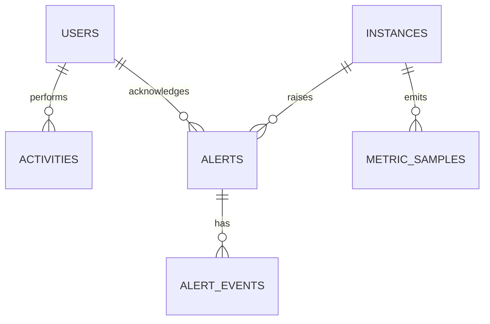

# CloudOps Command Center — Data Model

_Last reviewed 2026-10-20._

## 1. Current state: no database

There is **no database in the running system**. The SPA reads bundled
JavaScript modules in `src/data/` (mock mode is the default). Mutations
(start/stop, acknowledge/resolve, user create/update) are applied to
component state and disappear on reload. Settings are the only persisted
data, in `localStorage`.

The shapes below are therefore the **de facto contract** between the UI and
whatever backend replaces the mocks. Section 4 proposes the D1 schema that
matches them.

| Mock module | Entities | Consumed by |
| --- | --- | --- |
| `src/data/mockInstances.js` | 12 instances | `instanceService`, Instances, Monitoring |
| `src/data/mockAlerts.js` | 8 alerts | `alertService`, Alerts, Dashboard |
| `src/data/mockUsers.js` | 8 users | `userService`, Users |
| `src/data/mockActivities.js` | 20 activities | `activityService`, Activity Logs, Dashboard |
| `src/data/mockMetrics.js` | time series, resource split, health, summary | `monitoringService`, Dashboard, Monitoring |

## 2. Entity shapes (as rendered)

### 2.1 Instance

```js
{
  id: 'i-0a1b2c3d4e5f6g7h8',   // string, AWS-style id
  name: 'Production Web Server', // string
  type: 't3.large',              // string, t3.small … r5.xlarge (8 in mocks)
  region: 'us-east-1',           // us-east-1 | us-west-2 | eu-west-1 | ap-southeast-1
  az: 'us-east-1a',              // string
  privateIp: '10.0.1.15',        // dotted IPv4
  publicIp: '52.23.45.67',       // dotted IPv4
  state: 'running',              // running | stopped | pending
  cpu: 42,                       // number, percent 0–100
  networkIn: 1.2,                // number, MB/s (display unit)
  networkOut: 3.4,               // number, MB/s
  diskUsage: 45,                 // number, percent 0–100
  memoryUsage: 62,               // number, percent 0–100
  launchTime: '2025-01-15T08:30:00Z' // ISO-8601 UTC
}
```

`networkIn`/`networkOut` are rendered as `MB/s`; keep that unit when the
real API is wired (or change the formatter in the same commit).

### 2.2 Alert

```js
{
  id: 'alert-001',
  severity: 'warning',            // critical | warning | info
  title: 'High CPU Utilization',
  message: 'API Server CPU utilization reached 78%. Threshold: 75%.',
  resource: 'API Server',         // display label, denormalised
  resourceId: 'i-0b2c…',          // FK-ish to instance.id
  status: 'active',               // active | acknowledged | resolved
  created: '2025-07-29T14:32:00Z',
  acknowledged: false,            // boolean mirror of status !== 'active'
  resolvedAt: null,               // ISO string | null
  timeline: [                     // newest first in mocks
    { time: '2025-07-29T14:32:00Z', event: 'Alert triggered - CPU at 78%' }
  ]
}
```

`acknowledged` and `status` are redundant in the mock (status
`acknowledged` plus boolean `true`). Treat `status` as authoritative in a
real backend and derive the boolean on the client.

### 2.3 User

```js
{
  id: 'usr-001',
  name: 'Admin User',
  email: 'admin@cloudops.io',
  role: 'Admin',                  // Admin | Operator | Viewer
  status: 'active',               // active | inactive
  lastLogin: '2025-07-29T15:30:00Z', // ISO | '-' for never
  avatar: null,                   // URL | null → initials fallback
  createdAt: '2025-01-01T00:00:00Z'
}
```

Note: these are **directory records**, not auth identities. The signed-in
visitor comes from Freebuff and is matched to a record by verified email
(or `freebuff_sub`) once a backend exists. Today the Users page and the
session are unrelated.

### 2.4 Activity

```js
{
  id: 'act-001',
  user: 'Admin User',             // display name, or 'System'
  role: 'Admin',                  // Admin | Operator | Viewer | System
  action: 'START_INSTANCE',       // enum, see below
  resource: 'Production Web Server',
  result: 'Success',              // Success | Failed | Pending
  ip: '192.168.1.100',
  timestamp: '2025-07-29T15:30:00Z'
}
```

Action values used by the UI filters and badge colours:
`LOGIN`, `LOGOUT`, `START_INSTANCE`, `STOP_INSTANCE`, `RESTART_INSTANCE`,
`RESOLVE_ALERT`, `TRIGGER_ALERT`, `UPDATE_USER_ROLE`, `SCALE_UP`,
`CREATE_SNAPSHOT`, `MODIFY_INSTANCE`, `BACKUP_COMPLETE`,
`DEPLOY_APPLICATION`, `UPDATE_SECURITY_GROUP`, `VIEW_LOGS`.

### 2.5 Metrics

```js
// Time series point (hourly; 24 points for CPU, 6 for the others)
{ time: '00:00', value: 23 }

// Dashboard aggregate
{
  cpu: cpuMetrics,
  networkIn, networkOut, disk, memory,
  resourceStatus: [{ name: 'Running', value: 8, color: '#22c55e' }, …],
  systemHealth: { status: 'healthy', message: 'All systems operational', lastUpdated: 'Just now', uptime: '99.97%' },
  dashboardSummary: { totalInstances: 12, runningInstances: 8, stoppedInstances: 3, activeAlerts: 2, overallHealth: 'Healthy' }
}
```

`time` is a display label, not a timestamp — the chart does not do timezone
maths. A real API should return ISO timestamps and let the client format
them.

## 3. Relationships



- Instance 1—N Alert (`alert.resourceId` → `instance.id`; mocks are
  referentially consistent but nothing enforces it).
- Alert 1—N Timeline event (embedded array in mocks).
- User 1—N Activity (mocks denormalise name/role; a backend should store
  `user_id` and keep the display label for deleted users).
- User 1—N Settings (planned).

## 4. Planned D1 schema

Target: Cloudflare D1 on the same origin as the Worker, so the existing
session cookie authorises API calls without CORS or a second token. This
schema is **not applied** — no database exists yet.

```sql
PRAGMA foreign_keys = ON;

CREATE TABLE users (
  id             TEXT PRIMARY KEY,               -- 'usr-…'
  freebuff_sub   TEXT UNIQUE,                    -- OIDC subject from the session
  email          TEXT NOT NULL UNIQUE,
  name           TEXT NOT NULL,
  avatar_url     TEXT,
  role           TEXT NOT NULL DEFAULT 'Viewer'
                 CHECK (role IN ('Admin', 'Operator', 'Viewer')),
  status         TEXT NOT NULL DEFAULT 'active'
                 CHECK (status IN ('active', 'inactive')),
  last_login_at  TEXT,
  created_at     TEXT NOT NULL DEFAULT (datetime('now')),
  updated_at     TEXT NOT NULL DEFAULT (datetime('now'))
);
CREATE INDEX idx_users_role ON users(role);

CREATE TABLE instances (
  id               TEXT PRIMARY KEY,             -- 'i-…'
  name             TEXT NOT NULL,
  type             TEXT NOT NULL,
  region           TEXT NOT NULL,
  az               TEXT NOT NULL,
  private_ip       TEXT,
  public_ip        TEXT,
  state            TEXT NOT NULL
                   CHECK (state IN ('running', 'stopped', 'pending', 'terminated')),
  cpu_pct          REAL NOT NULL DEFAULT 0,
  memory_used_pct  REAL NOT NULL DEFAULT 0,
  disk_used_pct    REAL NOT NULL DEFAULT 0,
  network_in_mbps  REAL NOT NULL DEFAULT 0,
  network_out_mbps REAL NOT NULL DEFAULT 0,
  launch_time      TEXT,
  updated_at       TEXT NOT NULL DEFAULT (datetime('now'))
);
CREATE INDEX idx_instances_state  ON instances(state);
CREATE INDEX idx_instances_region ON instances(region);

CREATE TABLE alerts (
  id               TEXT PRIMARY KEY,             -- 'alert-…'
  severity         TEXT NOT NULL CHECK (severity IN ('critical', 'warning', 'info')),
  title            TEXT NOT NULL,
  message          TEXT NOT NULL,
  resource_label   TEXT NOT NULL,                -- denormalised display name
  instance_id      TEXT REFERENCES instances(id) ON DELETE SET NULL,
  status           TEXT NOT NULL DEFAULT 'active'
                   CHECK (status IN ('active', 'acknowledged', 'resolved')),
  created_at       TEXT NOT NULL DEFAULT (datetime('now')),
  acknowledged_by  TEXT REFERENCES users(id) ON DELETE SET NULL,
  acknowledged_at  TEXT,
  resolved_by      TEXT REFERENCES users(id) ON DELETE SET NULL,
  resolved_at      TEXT
);
CREATE INDEX idx_alerts_status   ON alerts(status);
CREATE INDEX idx_alerts_severity ON alerts(severity);
CREATE INDEX idx_alerts_created  ON alerts(created_at DESC);

CREATE TABLE alert_events (
  id         TEXT PRIMARY KEY,
  alert_id   TEXT NOT NULL REFERENCES alerts(id) ON DELETE CASCADE,
  event      TEXT NOT NULL,
  created_at TEXT NOT NULL DEFAULT (datetime('now'))
);
CREATE INDEX idx_alert_events_alert ON alert_events(alert_id, created_at DESC);

CREATE TABLE activities (
  id             TEXT PRIMARY KEY,               -- 'act-…' (or ULID)
  user_id        TEXT REFERENCES users(id) ON DELETE SET NULL,
  actor_label    TEXT NOT NULL,                  -- survives user deletion
  role           TEXT NOT NULL
                 CHECK (role IN ('Admin', 'Operator', 'Viewer', 'System')),
  action         TEXT NOT NULL,
  resource_label TEXT NOT NULL,
  instance_id    TEXT REFERENCES instances(id) ON DELETE SET NULL,
  result         TEXT NOT NULL CHECK (result IN ('Success', 'Failed', 'Pending')),
  ip             TEXT,
  created_at     TEXT NOT NULL DEFAULT (datetime('now'))
);
CREATE INDEX idx_activities_created ON activities(created_at DESC);
CREATE INDEX idx_activities_user    ON activities(user_id, created_at DESC);
CREATE INDEX idx_activities_action  ON activities(action, created_at DESC);

CREATE TABLE user_settings (
  user_id      TEXT PRIMARY KEY REFERENCES users(id) ON DELETE CASCADE,
  payload_json TEXT NOT NULL,                    -- validated server-side, not free-form
  updated_at   TEXT NOT NULL DEFAULT (datetime('now'))
);

-- Optional: raw samples for charts; keep instance row as the "latest" cache.
CREATE TABLE metric_samples (
  instance_id TEXT NOT NULL REFERENCES instances(id) ON DELETE CASCADE,
  metric      TEXT NOT NULL CHECK (metric IN ('cpu', 'memory', 'disk', 'network_in', 'network_out')),
  recorded_at TEXT NOT NULL,                     -- ISO-8601 UTC
  value       REAL NOT NULL,
  PRIMARY KEY (instance_id, metric, recorded_at)
);
CREATE INDEX idx_samples_recorded ON metric_samples(recorded_at);
```

### Design decisions

- **Text ISO-8601 UTC timestamps.** D1/SQLite has no date type; ISO strings
  sort correctly and round-trip through JSON without timezone ambiguity.
- **Role/status/severity CHECK constraints** keep bad enums out even if the
  API layer misses validation.
- **`actor_label` alongside `user_id`** preserves the audit trail when a
  user is deleted (audit logs must not lose the actor).
- **Latest metrics cached on `instances`**, raw history in
  `metric_samples`. The Instances table needs the latest value only; charts
  query samples.
- **No `acknowledged` boolean.** It is derived (`status !== 'active'`), so
  the two copies cannot drift.
- **`user_settings.payload_json`** stores the current Settings object; the
  Worker validates and whitelists keys rather than trusting arbitrary JSON.

## 5. Migration & seeding strategy

1. Add numbered SQL files under `migrations/` (`0001_init.sql`,
   `0002_…`). Apply with `wrangler d1 migrations apply <db>` per
   environment (preview and production are isolated databases).
2. Never edit an applied migration; add a new one.
3. Seed development data from `src/data/*.js` with a small script that
   inserts the mock rows, so the UI looks identical after cutover.
4. Feature-flag the cutover: ship the API and set `VITE_USE_MOCK=false`
   only when every endpoint in [API.md](./API.md) is live.
5. Back up before destructive changes: `wrangler d1 export` for the target
   environment.

## 6. Retention & privacy

- Activities: retain ≥ 12 months (audit requirement); export before prune.
- Metric samples: 30 days at hourly resolution; downsample older data or
  drop it.
- Alerts and their events: retain indefinitely until an explicit policy
  exists.
- Personal data: name, email, avatar URL and IP addresses. IPs are personal
  data in some jurisdictions — document the purpose (security audit) and
  restrict access to Admins.
- Deleting a user must **not** delete their activities; `ON DELETE SET NULL`
  plus `actor_label` handles this.
